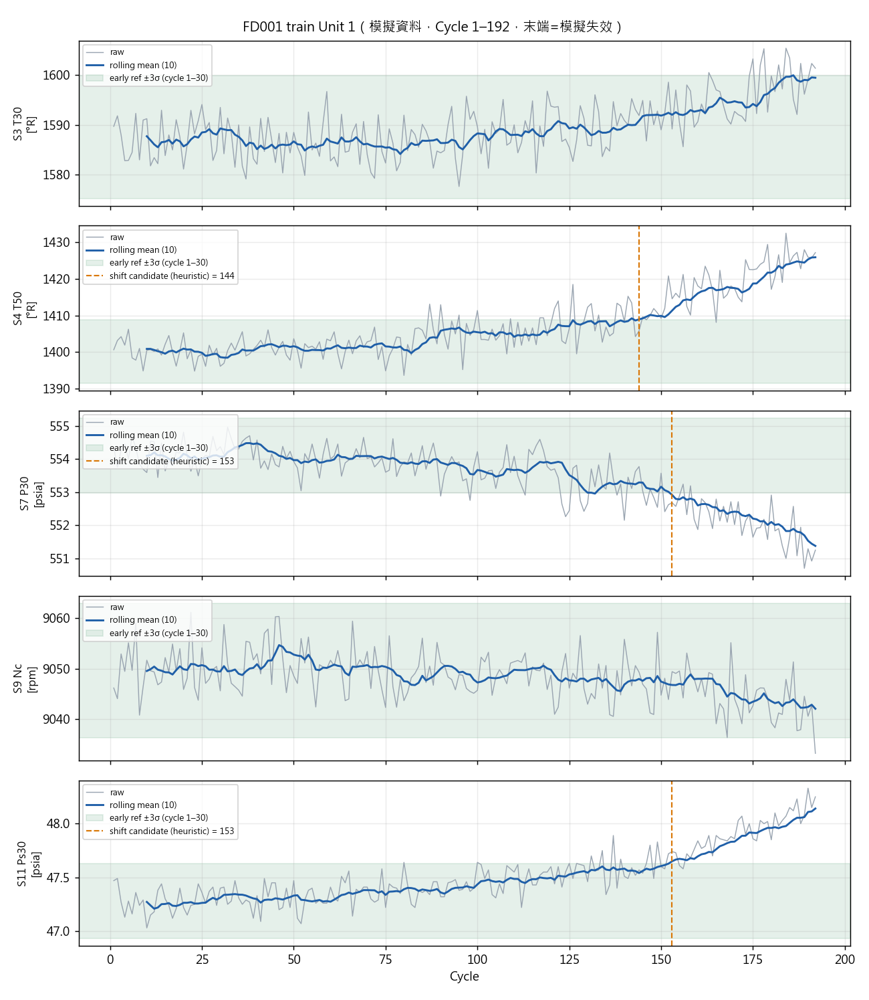
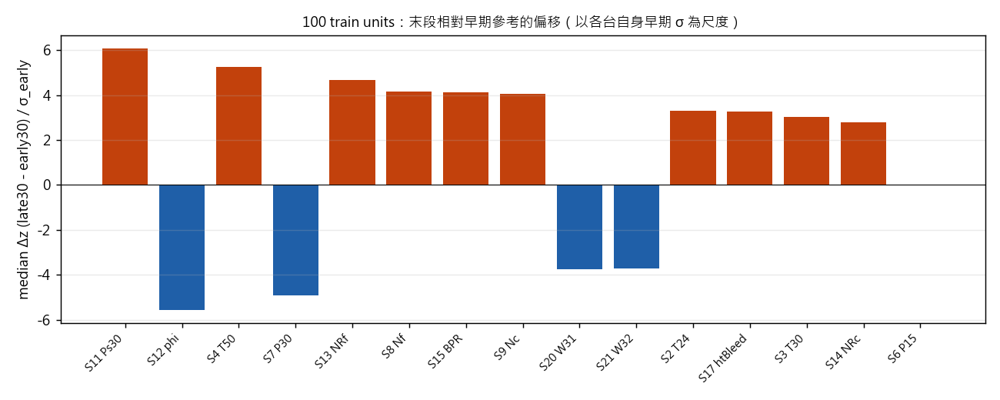
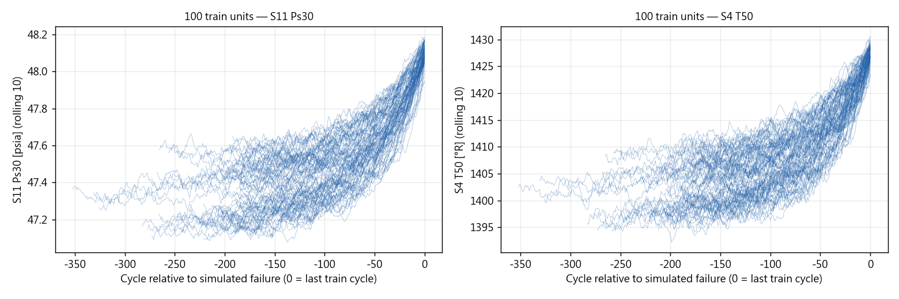

# M2 Trend & Quality Report — FD001

> 資料：NASA C-MAPSS FD001 航空渦輪扇發動機**模擬**劣化資料（非天然氣發電機實測）。
> 本報告描述「哪些通道有變化」，**不做故障診斷、不預測 RUL**。

- 產生時間（UTC）：2026-11-23T13:58:00+00:00
- 程式：`tools/analyze_fd001.py`；來源雜湊見 `outputs/M2_SOURCE_MANIFEST.json`
- train SHA256：`963b5e22825b34d8b21c69e1aeb4af3e647050eb672ee8834ba4b5d91d2de0f8`

## 方法（全部參數公開）

- **早期參考**：每台 train 引擎自身的 Cycle 1–30（平均、標準差 σ_early）。不使用任何外部門檻。
- **末段視窗**：每台最後 30 個 Cycle（Train 末端 = 模擬失效）。
- **Δz** =（末段平均 − 早期平均）/ σ_early：以該台自身雜訊為尺度的偏移量。
- **Spearman ρ**：通道值與 Cycle 的等級相關，描述單調趨勢強度。
- **偏移候選點（教學啟發式）**：10-Cycle 滾動平均首次超出早期 ±3σ，且此後持續在同一側直到末端。此參數為教學選擇、**未經驗證**，**不是 NASA 官方故障起始標籤**。

## 資料品質

- 結構檢查全數 PASS（見 `M2_SOURCE_MANIFEST.md`）：train 20631 列、test 13096 列、RUL 100 列，每列 26 欄，無缺值，Cycle 連續。
- train 中全程常數的通道：`s1, s5, s10, s16, s18, s19`（另 setting3 亦為常數）。單一工況下這些通道不帶趨勢資訊，分析時排除。
- train 每台壽命 128–362 Cycle（中位數 199）。

## 案例：train Unit 1

- 原始檔：`data/FD001/train_FD001.txt` 第 1–192 行，共 192 個 Cycle；第 192 行為模擬失效終點。
- 圖：`outputs/figures/unit1_multichannel.png`（S3 T30、S4 T50、S7 P30、S9 Nc、S11 Ps30）

| 通道 | 名稱 | 單位 | 早期平均 | 早期 σ | 末段平均 | 偏移候選 Cycle（啟發式） |
|---|---|---|---|---|---|---|
| S2 | T24 低壓壓縮機出口總溫度 | °R | 642.3283 | 0.328 | 643.342 | 182 |
| S3 | T30 高壓壓縮機出口總溫度 | °R | 1587.558 | 4.11 | 1597.482 | — |
| S4 | T50 低壓渦輪出口總溫度 | °R | 1400.107 | 2.9 | 1421.924 | 144 |
| S6 | P15 旁通流道總壓力 | psia | 21.61 | 3.61e-15 | 21.61 | — |
| S7 | P30 高壓壓縮機出口總壓力 | psia | 554.1057 | 0.375 | 551.9037 | 153 |
| S8 | Nf 風扇實際轉速 | rpm | 2388.062 | 0.0335 | 2388.239 | 160 |
| S9 | Nc 核心實際轉速 | rpm | 9049.642 | 4.46 | 9043.126 | — |
| S11 | Ps30 高壓壓縮機出口靜壓力 | psia | 47.28267 | 0.116 | 47.99533 | 153 |
| S12 | phi 燃油流量／Ps30 比值 | pps/psi | 522.062 | 0.372 | 520.1447 | 151 |
| S13 | NRf 修正後風扇轉速 | rpm | 2388.047 | 0.0295 | 2388.243 | 145 |
| S14 | NRc 修正後核心轉速 | rpm | 8132.631 | 3.62 | 8119.789 | 179 |
| S15 | BPR 旁通比 | 無因次 | 8.41161 | 0.019 | 8.49394 | 168 |
| S17 | htBleed 引氣焓值 | 原文未列 | 391.9333 | 0.98 | 394.9333 | 182 |
| S20 | W31 高壓渦輪冷卻引氣流量 | lbm/s | 38.97267 | 0.0844 | 38.584 | 160 |
| S21 | W32 低壓渦輪冷卻引氣流量 | lbm/s | 23.38546 | 0.0527 | 23.13657 | 166 |

## 全機隊（100 台 train）

| 通道 | 名稱 | 中位 Δ | 中位 Δz | 上升台數比例 | 中位 Spearman ρ |
|---|---|---|---|---|---|
| S11 | Ps30 高壓壓縮機出口靜壓力 (psia) | 0.595 | +6.09 | 100% | +0.82 |
| S12 | phi 燃油流量／Ps30 比值 (pps/psi) | -1.611 | -5.56 | 0% | -0.81 |
| S4 | T50 低壓渦輪出口總溫度 (°R) | 20.43 | +5.25 | 100% | +0.78 |
| S7 | P30 高壓壓縮機出口總壓力 (psia) | -1.886 | -4.91 | 0% | -0.77 |
| S13 | NRf 修正後風扇轉速 (rpm) | 0.135 | +4.68 | 100% | +0.76 |
| S8 | Nf 風扇實際轉速 (rpm) | 0.1333 | +4.15 | 100% | +0.77 |
| S15 | BPR 旁通比 (無因次) | 0.07888 | +4.14 | 100% | +0.72 |
| S9 | Nc 核心實際轉速 (rpm) | 17.63 | +4.07 | 71% | +0.74 |
| S20 | W31 高壓渦輪冷卻引氣流量 (lbm/s) | -0.3703 | -3.76 | 0% | -0.71 |
| S21 | W32 低壓渦輪冷卻引氣流量 (lbm/s) | -0.2218 | -3.72 | 0% | -0.71 |
| S2 | T24 低壓壓縮機出口總溫度 (°R) | 0.969 | +3.31 | 100% | +0.67 |
| S17 | htBleed 引氣焓值 (原文未列) | 3.017 | +3.28 | 100% | +0.66 |
| S3 | T30 高壓壓縮機出口總溫度 (°R) | 11.68 | +3.03 | 100% | +0.64 |
| S14 | NRc 修正後核心轉速 (rpm) | 9.499 | +2.79 | 58% | +0.66 |
| S6 | P15 旁通流道總壓力 (psia) | 0 | +0.00 | 47% | +0.13 |

## test 與 RUL

- test 每台最後 Cycle + RUL = 推得總壽命：141–341（中位數 199）；train 實際壽命 128–362（中位數 199）。兩者範圍相近，與「test 為截斷歷程、RUL 為截斷後剩餘 Cycle」的語意一致。
- 本專案**不建 RUL 模型**；網站只顯示 RUL 檔提供的真值（test）或明確標示為推得值（train）。

## 觀測 / 推論 / 未知

**觀測（Observed，可由原始列直接重算）**

- 末段相對早期明顯上升（|中位 Δz| > 2）：S11 Ps30, S4 T50, S13 NRf, S8 Nf, S15 BPR, S9 Nc, S2 T24, S17 htBleed, S3 T30, S14 NRc。
- 末段相對早期明顯下降：S12 phi, S7 P30, S20 W31, S21 W32。
- 偏移較弱（|中位 Δz| ≤ 2）：S6 P15。
- 常數通道：`s1, s5, s10, s16, s18, s19`。
- 所有 train 引擎皆在末端結束（模擬失效）；test 引擎在失效前截斷，RUL 另檔提供。

**推論（Inferred，需物理證據查證）**

- HPC 出口溫度（T30）、LPT 出口溫度（T50）、HPC 出口靜壓（Ps30）末段上升，HPC 出口總壓（P30）與 phi（燃油流量／Ps30）、冷卻引氣 W31/W32 末段下降，與 FD001 readme 所述「HPC 劣化」模擬情境的定性預期一致：壓縮效率下降 → 為維持推力需更高溫度與燃油。這是與文獻情境相符的假說，不是本資料證明的機制。
- 偏移候選點只說明「從何時開始超出自身早期雜訊」，不等於劣化起點。

**未知（Unknown）**

- 各台精確的故障／劣化起始 Cycle（NASA 未標註）。
- 真實硬體證據（孔探、油液、振動等）；FD001 為模擬資料，無實機可查。
- 啟發式參數（前 30 Cycle 參考、10 滾動、±3σ）的敏感度與誤報率。
- 結果能否外推到天然氣發電機：不能直接外推。

## 限制

- 早期參考假設前 30 個 Cycle 為「相對健康」；FD001 引擎起始即帶有未知程度的初始磨耗與製造差異。
- 未做感測器雜訊濾除以外的任何前處理；滾動平均僅用於圖示與候選點。
